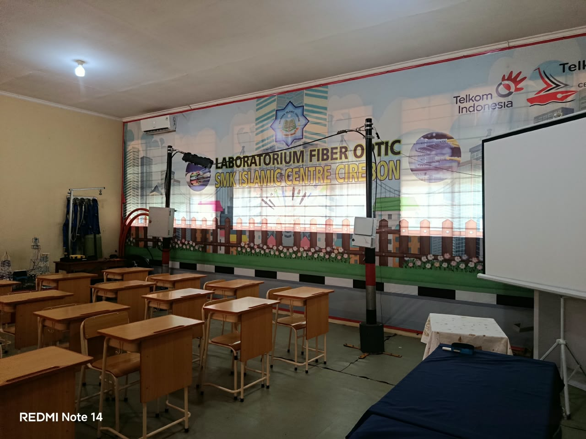
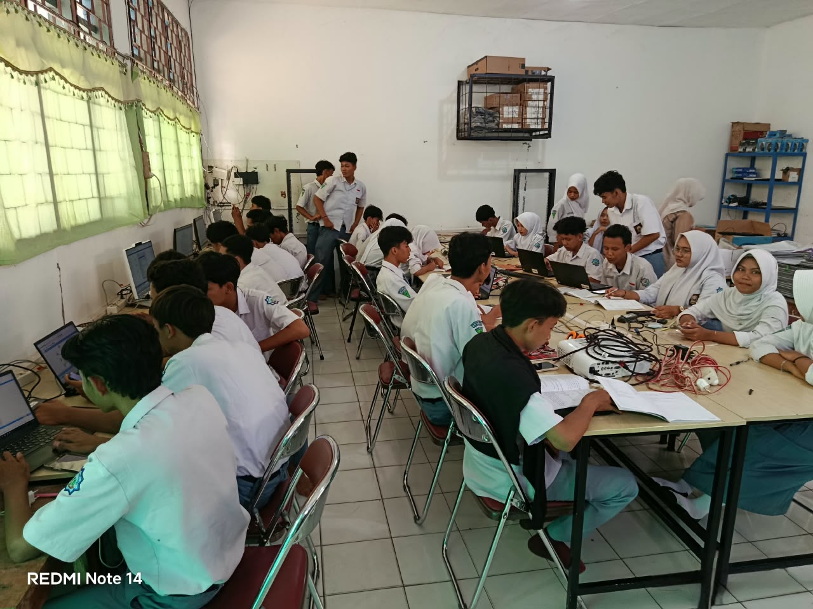
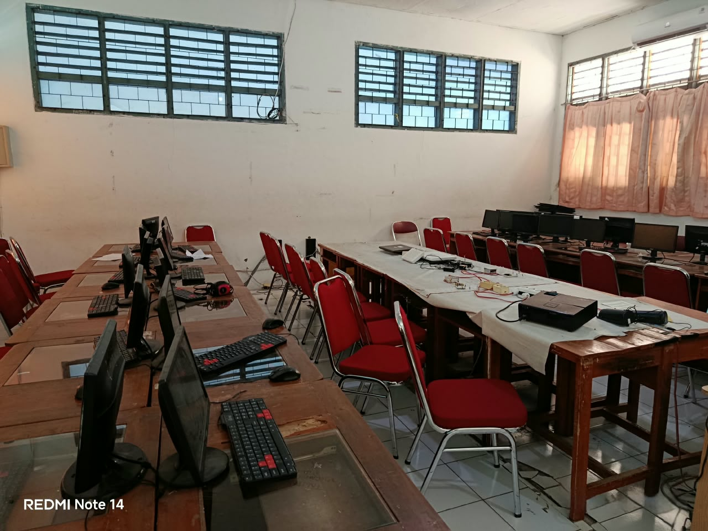
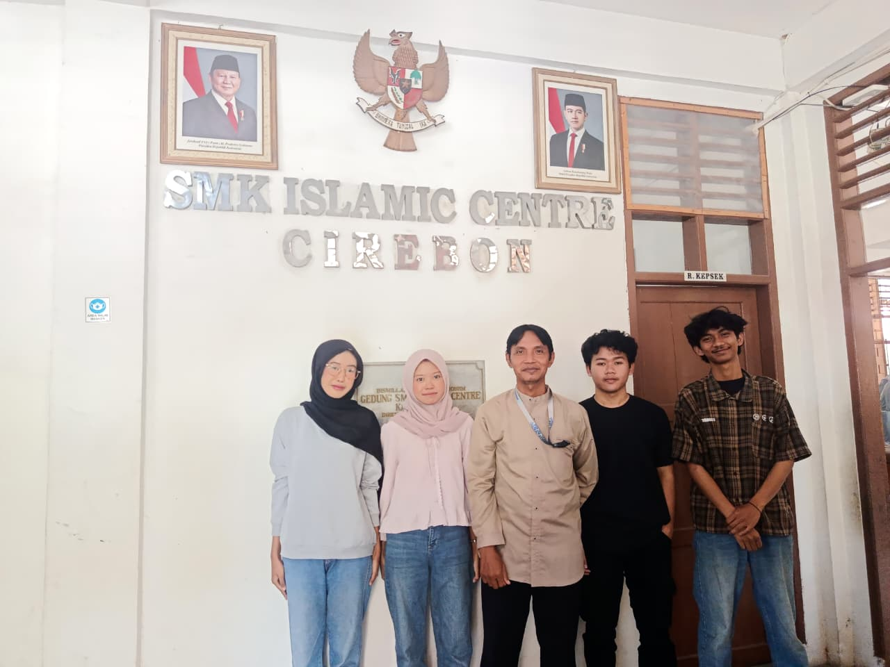

# Laporan Project Kelompok 3

### Anggota Kelompok ###
1. Rizky Fadilah (2488010040)
2. Najwa Ramadhan (2488010001)
3. Salwa Ayudia Putri (2488010042)
4. Mifa Miftahul Falaah (2488010072)

### Tema Project ###
Sistem Peminjaman dan Pengelolaan Laboratorium SMK Islamic Center Cirebon

### Fitur Utama ###
1. Dashboard Guru: Menampilkan ringkasan pengajuan peminjaman, jumlah laboratorium, pengajuan hari ini, serta riwayat pengajuan peminjaman.
2. Manajemen Laboratorium: Menampilkan daftar laboratorium beserta informasi nama,Kapasitas dan ketersediaan laboratorium.
3. Jadwal Laboratorium: Menampilkan jadwal penggunaan laboratorium berdasarkan hari, waktu, mata pelajaran, guru, dan kelas, serta menyediakan filter jadwal.
4. Peminjaman Laboratorium: Memfasilitasi guru dalam mengajukan peminjaman laboratorium dengan mengisi informasi kebutuhan peminjaman.
5. Riwayat Peminjaman: Menampilkan daftar pengajuan peminjaman beserta status pengajuan, seperti pending, disetujui, dan ditolak.
6. Manajemen Akun: Menyediakan fitur login dan pengelolaan akses pengguna sesuai perannya.

### Dokumentasi Wawancara ###

### Notulensi: ###
1. Penggunaan laboratorium membutuhkan pengaturan jadwal agar tidak terjadi benturan penggunaan oleh beberapa guru atau kelas.
2. Informasi mengenai laboratorium, nama dan kapasitas, perlu disajikan secara terstruktur.
3. Guru membutuhkan informasi jadwal laboratorium berdasarkan hari dan waktu penggunaan.
4. Pengajuan peminjaman laboratorium perlu dicatat agar dapat dipantau dan ditelusuri kembali.
5. Status pengajuan peminjaman perlu dibedakan menjadi pending, disetujui, dan ditolak.
6. Riwayat pengajuan dibutuhkan untuk memudahkan guru melihat pengajuan yang pernah dilakukan.
7. Informasi jadwal perlu mencakup waktu penggunaan, mata pelajaran, guru, dan kelas yang menggunakan laboratorium.
8. Sistem diharapkan dapat membantu guru memperoleh informasi laboratorium dan jadwal penggunaan secara lebih mudah.
9. Sistem diharapkan dapat meningkatkan keteraturan pencatatan dan mengurangi risiko benturan jadwal penggunaan laboratorium.

### Pembagian Tugas ###

1. Rizky Fadilah
   - Membuat tampilan halaman Login.
   - Membuat tampilan halaman Splash Screen.

2. Salwa Ayudia Putri
   - Membuat tampilan halaman Dashboard.
   - Membuat tampilan halaman Daftar Lab.

3. Najwa Ramadhan
   - Membuat tampilan halaman Jadwal Laboratorium.

### Hasil Halaman

1. Splash Screen
(Lampirkan screenshot atau GIF halaman Dashboard.)

2. Login
(Lampirkan screenshot atau GIF halaman Dashboard.)

3. Dashboard Guru
(Lampirkan screenshot atau GIF halaman Dashboard.)

4. Daftar Laboratorium
(Lampirkan screenshot atau GIF halaman Dashboard.)

5. Jadwal Laboratorium
(Lampirkan screenshot atau GIF halaman Dashboard.)