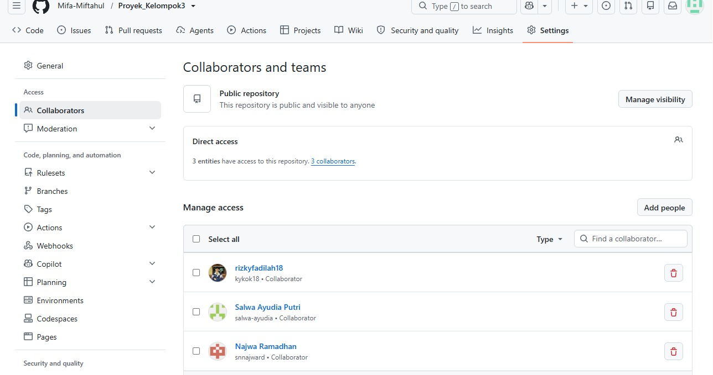
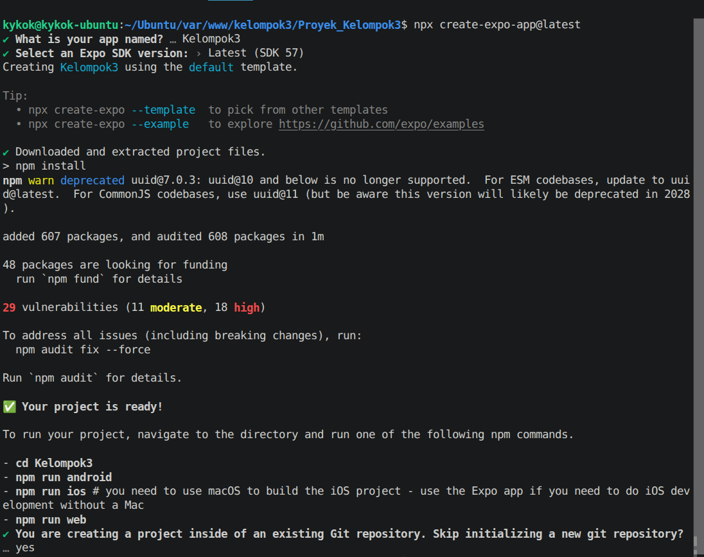
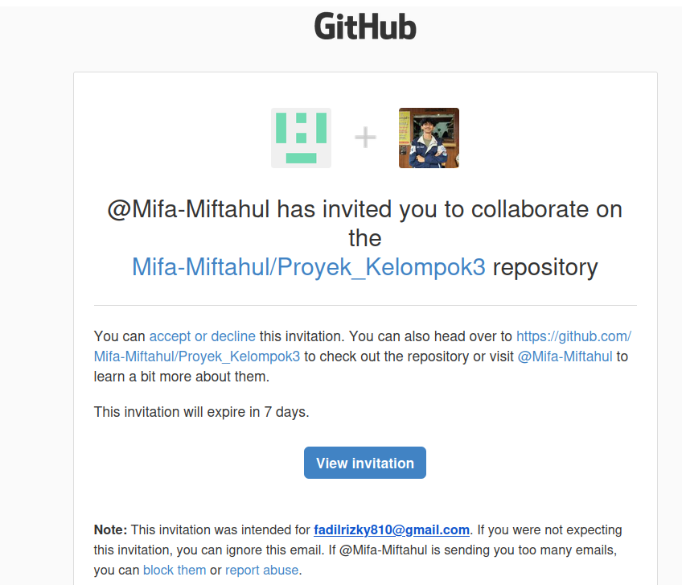
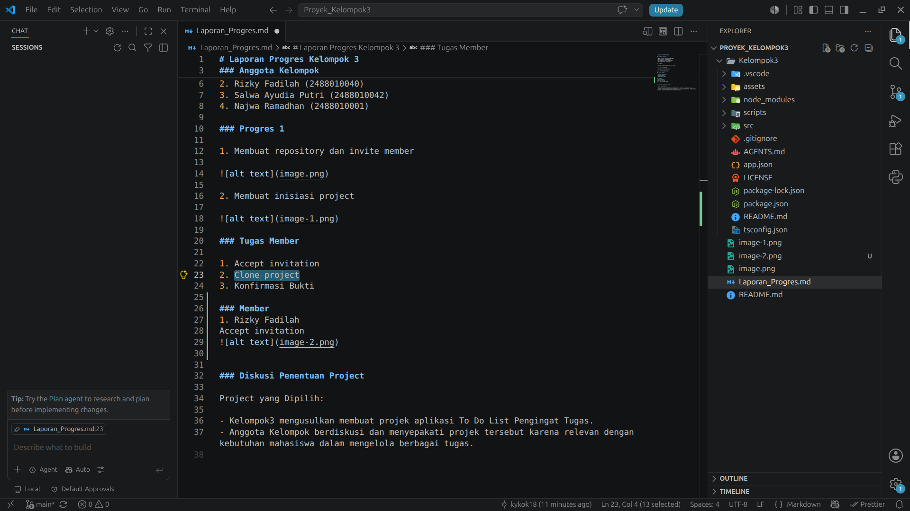
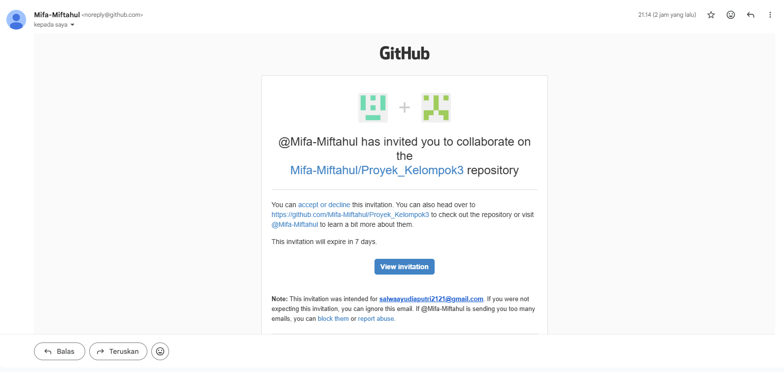
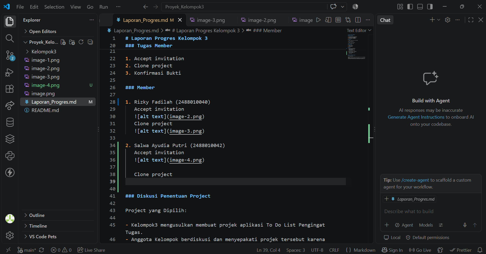
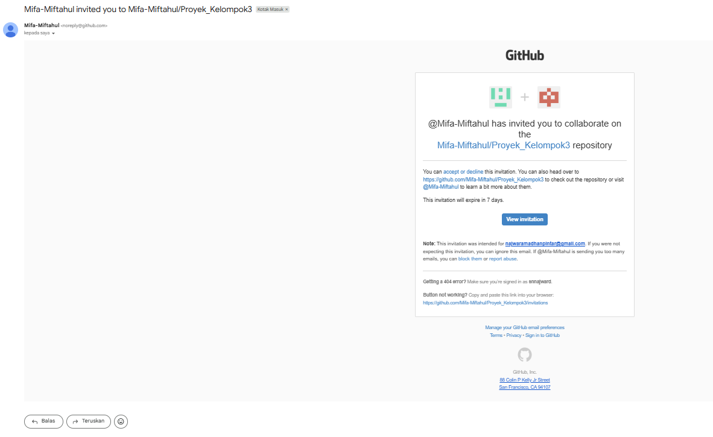
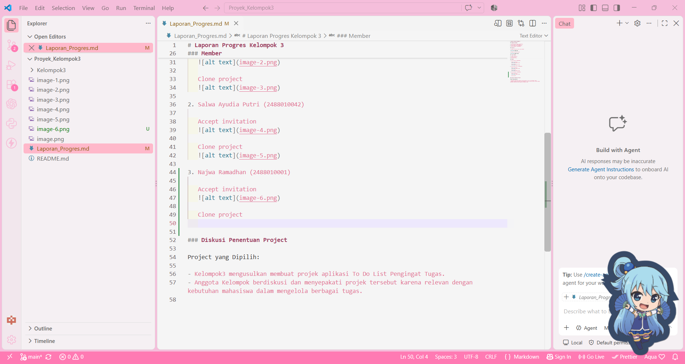

# Laporan Progres Kelompok 3

### Anggota Kelompok

1. Mifa Miftahul Falaah (2488010072)
2. Rizky Fadilah (2488010040)
3. Salwa Ayudia Putri (2488010042)
4. Najwa Ramadhan (2488010001)

### Progres 1

1. Membuat repository dan invite member

2. Membuat inisiasi project

### Tugas Member

1. Accept invitation
2. Clone project
3. Konfirmasi Bukti

### Member

1. Rizky Fadilah (2488010040)

   Accept invitation
   
   
   Clone project
   

2. Salwa Ayudia Putri (2488010042)

   Accept invitation
   

   Clone project
   

3. Najwa Ramadhan (2488010001)

   Accept invitation
   

   Clone project
   

### Diskusi Penentuan Project

Project yang Di Diskusikan:

Membuat projek aplikasi Kelola Lab Komputer dan Jaringan.
- Anggota Kelompok berdiskusi untuk membuat projek tersebut karena relevan dengan kebutuhan guru dalam meminjam lab agar tidak bentrok dengan kelas lain.