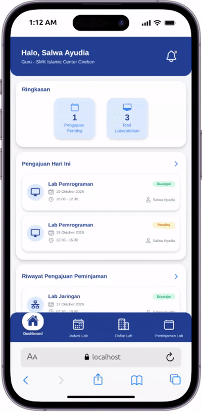
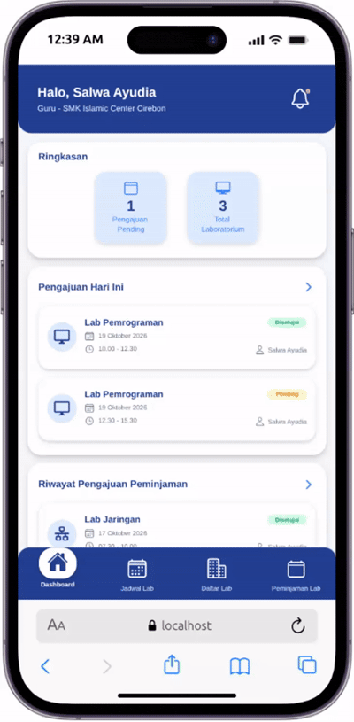
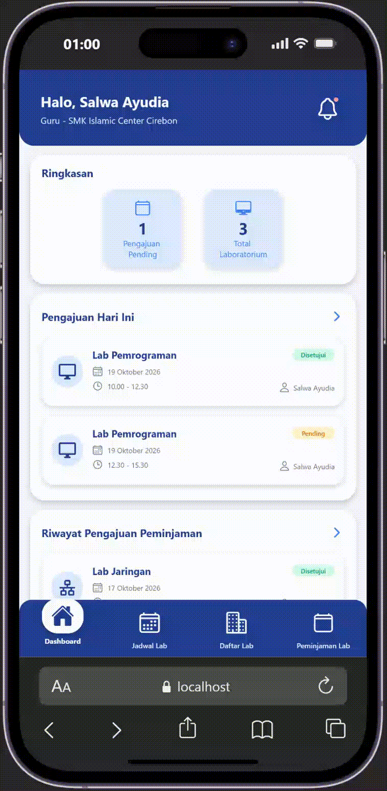
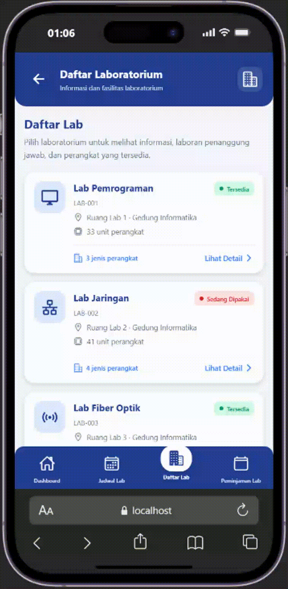
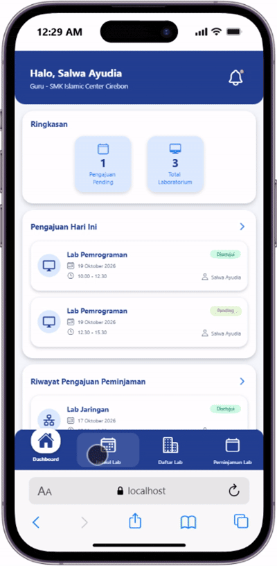

# SILAKOM
SILAKOM merupakan aplikasi berbasis digital yang dikembangkan untuk membantu pengelolaan informasi laboratorium, jadwal penggunaan, dan pengajuan peminjaman laboratorium di lingkungan sekolah.

Aplikasi ini dirancang untuk memudahkan guru dalam memperoleh informasi laboratorium, melihat jadwal penggunaan berdasarkan hari dan waktu, serta mengajukan peminjaman laboratorium secara lebih terstruktur. SILAKOM juga membantu pengelola dalam mencatat dan memantau pengajuan peminjaman sehingga penggunaan laboratorium dapat berjalan lebih tertib dan terorganisasi.

## Daftar Screen###
### 1. Splash Screen

### 2. Login

### 3. Dashboard Guru

### 4. Daftar Laboratorium

### 5. Jadwal Laboratorium

## Cara Menjalankan Proyek
1. Clone repository:
    git clone https://github.com/Mifa-Miftahul/Proyek_Kelompok3

2. Masuk ke folder aplikasi:
    cd "Kelola-PeminjamanLabb"

3. Install dependency:
    npm install

4. Jalankan aplikasi:
    npx expo start

5. Setelah Expo berjalan, aplikasi dapat dibuka melalui Expo Go, emulator, atau web sesuai environment yang digunakan.
