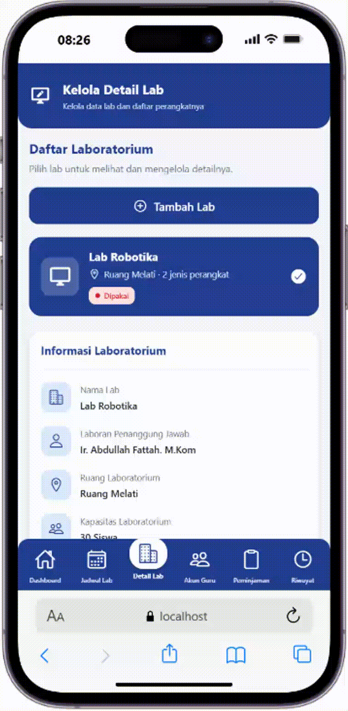
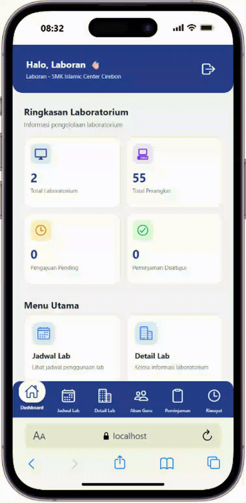

# Integrasi Project Silakom ke Supabase

## Anggota Kelompok
1. Mifa Miftahul Falaah
2. Rizky Fadilah
3. Najwa Ramadhan
4. Salwa Ayudia Putri

## Setup Supabase
1. Invite Anggota

2. Tabel Database

3. Skema Tabel Supabase

## Halaman yang sudah terkoneksi
1. konfirmasi peminjaman lab (Laboran)

2. laporan peminjaman lab (Laboran)

3. kelola perangkat lab (Laboran)

4. Login

5. Dashboard (Laboran)

6. Kelola akun Guru

