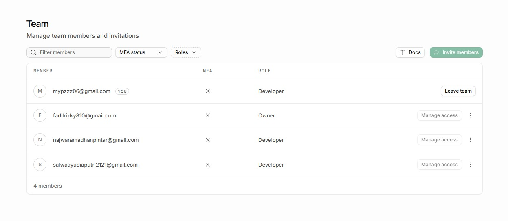
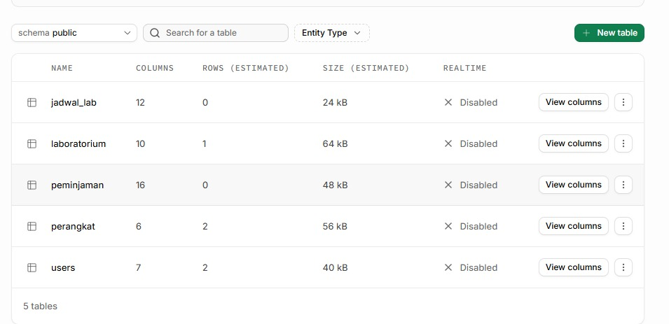
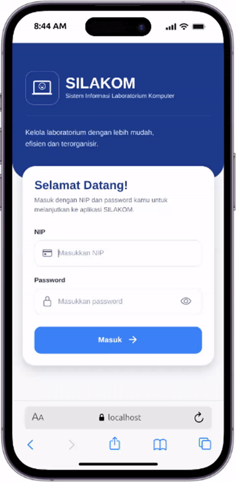
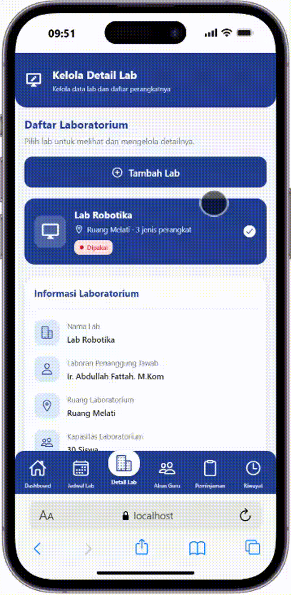
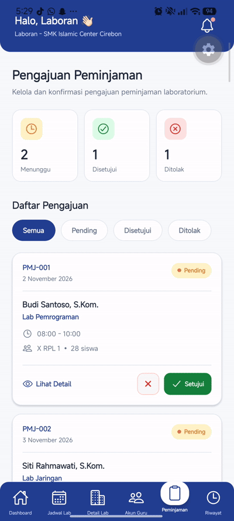
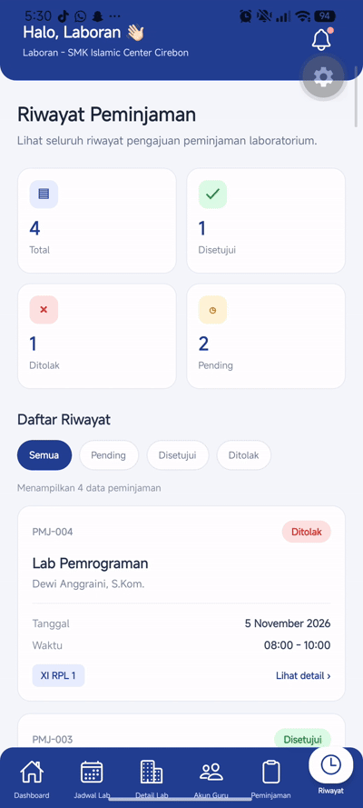

# Integrasi Project Silakom ke Supabase

## Anggota Kelompok
1. Mifa Miftahul Falaah
2. Rizky Fadilah
3. Najwa Ramadhan
4. Salwa Ayudia Putri

## Setup Supabase
1. Invite Anggota

2. Tabel Database

3. Skema Tabel Supabase

## Halaman yang sudah terkoneksi
1. Login(Laboran)

2. Dashboard (Laboran)

3. Kelola Lab (Laboran)

4. Kelola perangkat Lab (Laboran)

5. Kelola akun guru (Laboran)

6. Konfirmasi peminjaman lab (Laboran)

7. laporan peminjaman lab (Laboran)

